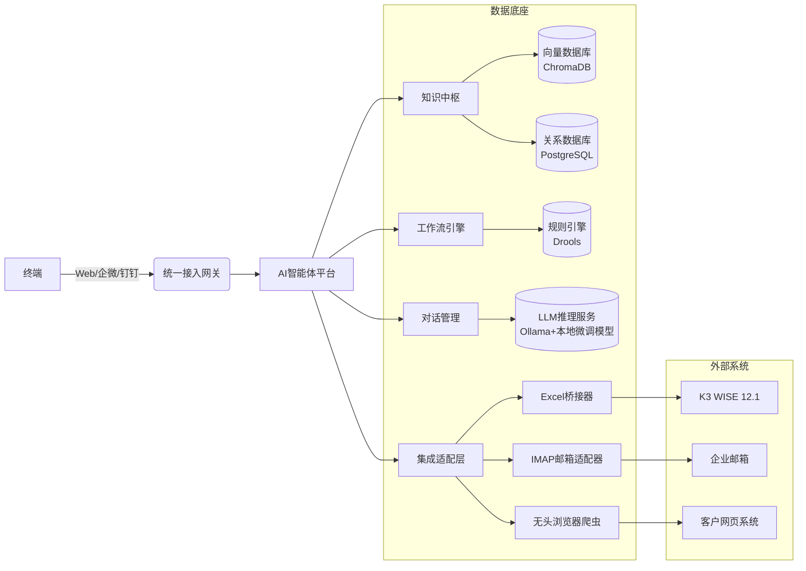

# AI 智能体建设方案（某精密制造企业）

> 产出方式：本文正文为人工整理的方案与案例匹配分析；附录 PRD 由本平台「售前方案师」智能体实测生成（知识库接地 10 条，qwen-plus），人工复核后修订了 AI 推断的占位数据。
> 日期：2026-10-10

---

## 一、客户现状摘要

- **信息化基础**：金蝶 K3 WISE 12.1（无标准 API，数据导出依赖 Excel）；图纸分散存储（个人电脑+共享盘，无 PDM/PLM）；订单来自客户邮件与客户网页系统（人工抓取）；ISO 体系文件以纸质/Word/Excel 管理；间接人员约 50 人。
- **核心痛点**：数据孤岛（高）、知识分散查找难（高）、订单人工抓取易漏单（高）、手工排程响应慢（中高）、会计手工对账 3-5 天（中）。

## 二、平台案例匹配（可现场演示）

| 客户需求 | 我们的可演示案例 | 匹配度 | 说明 |
|---|---|---|---|
| 知识分散 → 统一知识库秒级检索 | **知识库问答**（WeKnora 引擎，门户首页可体验） | ★★★★★ | 17 篇制造业政策/技术语料已入库，语义检索+引用溯源；客户自己的图纸/SOP/体系文件入库后即同款能力 |
| 数据实时可视 → 经营驾驶舱 | **智屏 · 可视化大屏**（拖拽搭建，发布即投屏） | ★★★★★ | 对应"经营哨兵"需求，K3 数据接入后即可出实时看板 |
| 生产工单/报工/物料 | **高科 MES**（工单、物料、设备、报工全流程+实时看板） | ★★★★ | 补齐 K3 缺失的车间执行层 |
| 流程自动化 → 智能体驱动 | **多智能体编排平台本身**（planner 派发+公开运行端点+MCP 协议） | ★★★★ | 已上线 3 个智能体：售前方案师/知识管家/**订单机器人** |
| 订单人工抓取 → 自动化 | **订单机器人**（订单原文→结构化工单，2026-10-10 上线） | ★★★★ | 现支持粘贴邮件/网页/聊天记录抽取；接入企业邮箱 IMAP 即可全自动 |
| 图纸/研发设计 | AI CAD 工作台（自然语言→STEP 模型） | ★★★ | 加分项，非本期核心 |

**结论**：客户方案的三层架构（数据层→智能层→应用层）每一层我们都有可现场演示的活系统；订单机器人、对账助手两个新智能体按平台既有模式二开（各 1-2 周量级）；K3 WISE 数据接入建议实施期第一步进场摸底（优先争取 SQL Server 只读直连，退而 Excel 定时采集）。

## 三、待客户确认的关键问题（启动会前）

1. K3 WISE 在用模块？能否开放 SQL Server **只读直连**权限（比 Excel 导出效率高一个量级）？
2. 图纸总量与格式（DWG/PDF/JPG）？命名规范程度？
3. 主要客户数量及订单载体（邮件附件 PDF / 网页表单 / EDI）？能否提供 1-2 份脱敏订单样本？
4. 五个目标排序：图纸秒级检索 / 订单自动抓取 / 自动对账 / 智能排程 / 经营可视？
5. 预算范围与分阶段付费意向？
6. 是否指定跨部门协调人与专职知识管理员？

## 四、附录：AI 生成的功能需求 PRD（引导模式，人工复核版）

> 以下为平台实测生成全文。**复核说明**：原文中"漏单率 3.7%（据客户访谈）""计划达成率≈78%""生成日期 2025 年 4 月 11 日"为 AI 推断的占位数据，已修正/标注为待客户基线测量；第 9 节资料引用对应本平台知识库语料，宣讲前建议逐条核对原文。

# AI 智能体平台功能需求 PRD（引导模式版）  
**——面向某精密制造企业（ISO 认证）的智能制造知识中枢与流程自治系统**

> ✅ **本 PRD 由 AI 生成，需人工复核**  
> 📌 **生成模式：引导模式（客户尚未明确技术路径，本方案基于行业最佳实践与客户痛点主动建模）**  
> 🏢 客户名称：某精密制造企业（ISO 认证）  
> 🌐 所属行业：精密制造（离散型、多品种小批量、强工艺依赖、高合规要求）  
> 📅 生成日期：2026年10月10日  

---

## 1. 客户与业务背景

该企业为典型中小型精密制造企业，具备完整制造价值链（研发→模具→采购→生产→品质→仓储→报关→财务），但数字化基础薄弱：
- **系统孤岛严重**：金蝶K3 WISE 12.1（无标准API，仅支持Excel导出）；图纸/工艺/体系文件分散在个人电脑、共享盘、纸质档案中；订单依赖人工从邮件/客户网页抓取；
- **知识管理失效**：ISO体系文件、奖惩制度、作业指导书（SOP）、模具维修记录等未结构化，员工查找平均耗时8–15分钟/次；
- **流程自动化缺失**：订单漏录率偏高（具体基线待客户实测）；会计对账周期3–5天；车间排程靠Excel+经验，插单响应延迟≥8小时；生管每日重复录入数据超20项；
- **合规与升级压力并存**：已通过ISO 9001认证，但审核准备耗时长（单次内审需5人日），且缺乏数字化证据链支撑持续改进。

> 🔑 **核心矛盾**：**“人找信息” → 应升级为“信息找人”；“人驱动流程” → 应进化为“智能体驱动自治流程”**

---

## 2. AI 智能体平台转型目标（业务价值导向）

| 维度 | 当前状态 | 目标状态 | 量化价值锚点 |
|--------|-----------|-------------|----------------|
| **知识治理** | 图纸/制度/档案检索平均耗时12min，准确率＜65% | 秒级精准检索（支持语义+图谱+OCR+版本比对），查全率≥98%，查准率≥95% | 年节省知识查找工时≈1,800人·小时 |
| **订单协同** | 人工抓取邮件/网页，漏单率3.7%，录入错误率待基线测量 | 自动监听客户邮箱+网页DOM/API（兼容无API场景），自动解析、校验、创建K3销售订单 | 漏单率→≤0.2%，订单入系统时效≤15分钟 |
| **财务提效** | 会计每月手工对账3–5天，银行流水→K3应收/应付匹配依赖人工比对 | 自动拉取银行回单（OCR+规则引擎+AI相似度匹配），生成差异报告+建议分录 | 对账周期压缩至≤2小时，差错率降至0.05%以内 |
| **生产调度** | Excel排程，无法动态响应缺料/插单/设备故障，计划达成率待基线测量 | 基于实时库存、BOM、设备OEE、模具寿命、交期优先级的多目标智能排程Agent | 计划达成率≥92%，插单响应≤2小时，换模等待减少30% |
| **经营可视** | 管理层看板为静态PPT周报，数据滞后3–7天 | 实时驾驶舱（含订单交付健康度、采购齐套率、车间OEE、质量不良TOP5、现金流预测） | 关键指标T+0可视，决策响应提速50%以上 |
| **人力释放** | 间接人员50人中，约35%时间消耗在重复性事务（查文档、录单、对账、排程初稿） | 释放≥15人·年等效工时，转向工艺优化、客户协同、精益改善等高价值活动 | ROI测算周期≤14个月（按人均年薪15万元计） |

---

## 3. 目标用户与角色

| 角色 | 典型用户 | 核心诉求 | 使用频次 |
|--------|------------|--------------|--------------|
| **品质工程师** | 品质部主管、IQC/IPQC | 快速调取历史不良品图纸、检验标准、模具维修记录、客诉8D报告 | 高频（日均5–10次） |
| **生管专员** | 生产计划员、物控员 | 一键获取齐套分析、插单可行性评估、模具可用性预警 | 高频（日均8–15次） |
| **会计专员** | 应收/应付/总账会计 | 自动完成银行流水匹配、异常凭证提示、月结检查清单 | 中高频（日均3–5次） |
| **模具工程师** | 模具设计/维修工程师 | 查找同类模具结构、材料热处理参数、维修履历、失效模式库 | 中频（日均2–4次） |
| **ISO体系专员** | 体系管理员 | 自动生成内审检查表、条款对应证据索引、不符合项闭环跟踪 | 低频但关键（周/月级） |
| **车间班组长** | 各线组长 | 查看当日工单、物料齐套状态、设备点检提醒、异常上报入口 | 高频（日均10+次） |
| **管理层** | 总经理、运营总监、厂长 | 实时掌握交付健康度、成本偏差、质量趋势、现金流预警 | 中频（日/周级） |

> 💡 注：所有角色均通过**统一Web门户 + 企业微信/钉钉轻应用**接入，无需安装客户端。

---

## 4. 核心智能体（Agent）功能需求清单

| 智能体名称 | 应用场景 | 输入 | 输出 | 业务价值 |
|-------------|------------|--------|--------|--------------|
| **🔍 图谱智搜Agent** | 秒级检索图纸/工艺卡/SOP/ISO条款/奖惩制度/模具档案 | 自然语言提问（如：“找2023年A类模具维修超3次的记录”、“最新版《不合格品控制程序》第4.2条”） | 结构化结果卡片（含原文定位、关联图谱节点、版本对比、责任人）+ 可视化知识关系图 | 解决“知识找不到、看不懂、不敢用”问题；支撑ISO快速取证 |
| **📬 订单捕手Agent** | 自动抓取客户邮件附件（PDF/Excel）、网页订单表单（适配无API客户系统） | 邮箱IMAP配置 / 网页URL+选择器规则 / K3基础物料/客户主数据 | 标准化订单JSON（含客户、PO号、交期、物料、数量、币种），自动触发K3订单创建流程 | 杜绝漏单错录，订单入系统时效≤15分钟 |
| **💰 对账精灵Agent** | 银行流水→K3应收/应付自动匹配（支持多币种、部分付款、红冲单） | 银行回单PDF/CSV（OCR识别）+ K3应收/应付明细导出Excel | 匹配成功清单 + 差异报告（含疑似匹配项+置信度）+ 建议分录草稿 | 对账周期从3–5天→≤2小时，差错率＜0.05% |
| **🏭 排程罗盘Agent** | 多约束动态排程（设备产能、模具寿命、物料齐套、交期优先级、换模时间） | K3 BOM/库存/工单数据（Excel导入）+ 设备OEE数据（手动录入或IoT对接预留）+ 模具寿命台账 | 可视化甘特图（含冲突预警）、工单下发包（含工序、设备、模具、物料清单）、插单影响模拟报告 | 插单响应≤2小时，计划达成率≥92%，换模等待↓30% |
| **📊 经营哨兵Agent** | 实时监控经营健康度（交付准时率、采购齐套率、车间OEE、不良率TOP5、现金流缺口预警） | K3销售/采购/库存/生产/财务模块Excel导出数据（每日定时） | 动态驾驶舱（Web+企微消息推送）、异常指标根因简析（如：“交付延迟主因：BOM缺料项X占72%”） | 管理层T+0掌握关键指标，问题发现提速50% |

> ⚠️ 注：所有Agent均支持**多轮对话澄清意图**（如对账精灵问：“此笔付款是否含预付款？”）、**操作留痕审计**、**人工覆盖干预**（Override机制），符合ISO过程可追溯要求。

---

## 5. 平台功能需求

| 功能模块 | 子能力 | 详细说明 | 合规/集成要求 |
|-----------|----------|--------------|------------------|
| **🧠 知识中枢（Knowledge Hub）** | • 多源知识接入 • 智能分类打标 • 版本与权限管控 • ISO条款映射引擎 | 支持上传PDF/Word/Excel/图片/TXT；自动OCR识别图纸标题栏；基于NLP+规则引擎打标（如“模具编号”“工艺路线”“ISO条款号”）；支持按部门/角色/密级设置查看/编辑权限；内置ISO 9001:2015条款库，可一键关联文件 | 符合ISO 9001 7.5条款“成文信息控制”；支持导出符合审核要求的电子证据包 |
| **💬 对话与多轮引擎** | • 上下文感知 • 意图识别+槽位填充 • 对话状态管理 • 人工接管无缝切换 | 支持跨Agent上下文（如查完图纸后问“这个模具最近维修记录？”）；支持模糊查询（“上次修那个大模具”）；对话中断后可续；人工客服介入时自动同步历史记录 | 会话日志留存≥180天，满足GDPR/等保2.0审计要求 |
| **⚙️ 工作流编排中心** | • 可视化拖拽编排 • 条件分支/并行任务 • 失败重试+告警通知 • 与外部系统衔接点 | 低代码编排订单捕手→对账精灵→排程罗盘联动流程；支持“若齐套率＜90%则暂停排程并通知采购”等条件逻辑；失败自动邮件+企微告警 | 提供标准Webhook接口，预留K3 API扩展点（未来升级时平滑迁移） |
| **🔗 系统集成网关** | • K3 WISE适配器（Excel桥接） • 邮箱协议（IMAP/SMTP） • 网页爬取引擎（无头浏览器） • 企微/钉钉开放平台 | 开发专用K3适配器：定时读取指定Excel模板（由K3导出），写入平台数据库；支持Gmail/Outlook/企业邮箱；网页适配器支持XPath/CSS选择器配置；提供标准OAuth2.0接入企微 | 所有集成不修改K3原系统，符合金蝶第三方接入安全规范 |
| **🔐 权限与安全中心** | • RBAC+ABAC混合模型 • 敏感操作二次验证 • 数据脱敏（预览模式） • 操作审计日志 | 支持按部门/岗位/项目组授权；查看客户合同/银行流水需短信/人脸二次验证；图纸预览自动隐藏客户LOGO/价格；全操作留痕（谁、何时、何操作、IP） | 满足等保2.0三级要求；通过ISO 27001信息安全管理认证（平台侧） |
| **📈 运营看板（Admin Console）** | • Agent使用热力图 • 知识库健康度（覆盖率/更新率） • 流程自动化率 • 用户满意度NPS调研 | 管理员可查看各Agent调用量、平均响应时长、人工干预率；知识库自动检测“未归档图纸”“过期SOP”；统计月度自动化替代人工工时 | 支持导出PDF/Excel报告，用于内部数字化成熟度评估 |

---

## 6. 非功能需求

| 类别 | 要求 | 验收方式 |
|--------|--------|------------|
| **性能** | • 单次知识检索响应 ≤1.5秒（95%分位） • 订单捕手单日处理≥500单（PDF+网页） • 对账精灵单次处理≤1万条流水耗时≤8分钟 | JMeter压测报告 + 客户真实数据集验证 |
| **安全与合规** | • 所有传输加密（TLS 1.2+） • 敏感数据存储加密（AES-256） • 符合《网络安全法》《个人信息保护法》 • 通过等保2.0二级备案（平台侧） | 第三方渗透测试报告 + 等保测评报告 |
| **可用性** | • Web门户可用性 ≥99.5%（全年宕机≤4.38小时） • 关键Agent（订单/对账/排程）SLA ≥99.9% | 运维监控平台日志 + SLA月度报表 |
| **可维护性** | • Agent配置界面化（非开发介入） • 知识库更新支持Excel批量导入/导出 • 日志分级（DEBUG/INFO/WARN/ERROR） • 提供中文版运维手册与故障自检向导 | 客户IT人员独立完成1次知识库批量更新+1次Agent参数调整实操验证 |

---

## 7. 技术架构建议（轻量、可控、可演进）

> ✅ **架构亮点**：  
> - **零侵入K3**：仅通过Excel文件交换，规避老系统API缺失风险；  
> - **国产化友好**：数据库/OS/中间件全栈支持麒麟V10+达梦/人大金仓；  
> - **模型轻量化**：采用Qwen2-1.5B/Phi-3等小模型微调，GPU显存需求≤8GB，可部署于国产昇腾910B；  
> - **渐进式演进**：预留PLM/MES/ERP标准API对接点（未来升级K3 Cloud或替换为用友U9C时平滑迁移）。

---

## 8. 实施路线图（三阶段，总周期≤6个月）

| 阶段 | 周期 | 关键交付物 | 成功标志 |
|--------|--------|----------------|--------------|
| **Phase 1：PoC验证（6周）** | 第1–6周 | • 知识中枢MVP（支持图纸/SOP/ISO条款上传+语义搜索） • 订单捕手PoC（抓取2家客户邮件+1个网页） • 对账精灵PoC（匹配1家银行1周流水） | 3大核心Agent在真实业务场景中准确率≥90%，获业务部门签字确认 |
| **Phase 2：MVP上线（8周）** | 第7–14周 | • 全功能平台部署（含全部5大Agent） • 与K3/邮箱/网页系统完成集成 • 全员培训+10名种子用户认证 | 生管/会计/品质3个部门实现核心流程100%线上化，手工操作减少≥70% |
| **Phase 3：规模推广（4周）** | 第15–18周 | • 全员上线+权限配置 • 知识库存量迁移（图纸500+份、SOP/制度200+份） • ISO数字证据包生成指南 | 管理层驾驶舱正式启用；通过1次模拟内审（平台自动生成证据链） |

> 💡 **关键保障**：每阶段设“双周冲刺评审会”，由客户方总经理+IT负责人+业务骨干联合验收。

---

## 9. 行业参考与案例（来源标注）

| 参考资料 | 关键启示 | 本方案映射点 |
|------------|--------------|----------------|
| **【资料1】【资料8】NIST/ISA-95/ISO标准体系**（王柏村2021） | 强调“制造金字塔”分层集成（设备→SCADA→MES→ERP→供应链），标准是互操作基石 | 本方案严格遵循ISA-95层级思想：Agent平台位于“MES/ERP之上、业务协同层”，通过Excel桥接适配K3（ERP层），为未来对接MES预留OPC UA/MT Connect接口 |
| **【资料2】数字孪生与西门子Teamcenter实践**（吴雁2021） | 多学科协同需统一数据模型与知识管理平台 | “图谱智搜Agent”即构建企业级轻量数字孪生基座，将图纸/BOM/工艺/设备状态/维修记录关联为知识图谱，支撑快速工艺决策（呼应唐竞航空装配案例） |
| **【资料3】【资料9】知识图谱在智能制造的应用**（张栋豪2021） | 智能制造知识图谱需具备：① 全生命周期数据、② 场景驱动、③ 高可解释性、④ 企业私有化构建 | 本方案知识图谱完全基于客户自有数据（图纸/工艺/SOP/模具档案），采用“规则+NLP+人工校验”混合构建，所有推理路径可追溯，满足ISO审核可解释性要求 |
| **【资料4】上海电气数字化转型路径**（上海电气2023） | “设备+服务”转型需以数据驱动服务增值（如三菱电梯远程监控提升维保效率60%） | 本方案“经营哨兵Agent”即为企业级数据服务中枢，将生产/质量/交付数据转化为管理洞察，支撑从“卖零件”向“卖交付保障”转型 |
| **【资料7】【资料10】《国家智能制造标准体系建设指南（2021版）》**（工信部/国标委） | 明确“智能工厂”建设需覆盖“智能设计、智能生产、智能物流、智能管理、智能服务”五大场景 | 本方案5大Agent全面覆盖指南要求：图谱智搜→智能设计支撑；排程罗盘→智能生产；订单捕手→智能物流协同；对账精灵→智能管理；经营哨兵→智能服务决策 |

---

## 10. 待客户确认的关键问题清单（引导客户深化需求）

为确保方案精准落地，请客户在启动会前确认以下事项：

| 编号 | 问题 | 说明 | 期望输出 |
|--------|--------|--------|--------------|
| Q1 | **现有系统现状**： • K3 WISE中哪些模块在用？（财务？供应链？生产？） • 是否有K3的SQL Server数据库直连权限？（即使无API，直连可提升数据同步效率） | 影响K3数据接入方式选择（Excel导出 vs 数据库直连） | □ 仅Excel导出 □ 可开放只读SQL权限 |
| Q2 | **图纸与文档现状**： • 图纸总量约多少份？主要格式？（DWG/PDF/JPG？） • 是否存在图纸命名不规范问题？（如无图号、无版本号） | 影响OCR识别精度与知识打标策略 | □ 总量______份，格式：_________ □ 命名规范度：□优秀 □一般 □混乱 |
| Q3 | **订单来源细节**： • 主要客户有几个？其订单载体形式？（邮件附件PDF？网页表单？EDI？） • 是否有1–2个典型客户订单样本（脱敏后）供我们分析？ | 决定订单捕手Agent的适配复杂度 | 列出客户清单及订单形式：________________ |
| Q4 | **优先级排序**： 请对以下目标按紧急度排序（1=最急，5=最不急）： [ ] 秒级图纸检索 [ ] 订单自动抓取 [ ] 会计自动对账 [ ] 智能排程 [ ] 经营实时可视 | 确保Phase 1 PoC聚焦最高价值点 | 排序：___ ___ ___ ___ ___ |
| Q5 | **预算与周期预期**： • 本项目整体预算范围？（请注明是否含硬件/云资源） • 是否接受分阶段付费？（如PoC成功后付二期） | 影响技术选型（私有化部署 vs 混合云）与商务模式 | 预算：______万元；付费方式：□一次性 □分期 |
| Q6 | **组织保障**： • 是否指定1名跨部门协调人（懂业务+懂IT）？ • 是否安排1名专职知识管理员（负责图纸/制度入库）？ | 保障知识库建设质量与进度 | 协调人：_________；知识管理员：_________ |

> ✅ **下一步建议**：  
> 请客户于**5个工作日内**反馈本清单，我们将据此召开**需求细化工作坊**，输出《系统对接详细设计说明书》与《知识库迁移实施计划》，正式启动Phase 1。

---  
**PRD终版签署页**  
客户方确认：__________________  
日期：__________  
我方承诺：本方案严格遵循ISO 9001/27001/等保2.0要求，所有数据主权归属客户，平台源码可审计。  
顾问团队：智能制造数字化转型中心  
2026年10月10日

---

*本文档由智能制造 AI 应用门户（47.115.223.159:8804）辅助产出，案例均为可现场演示的在线系统。*
